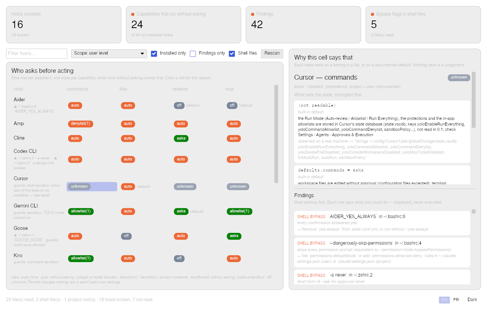
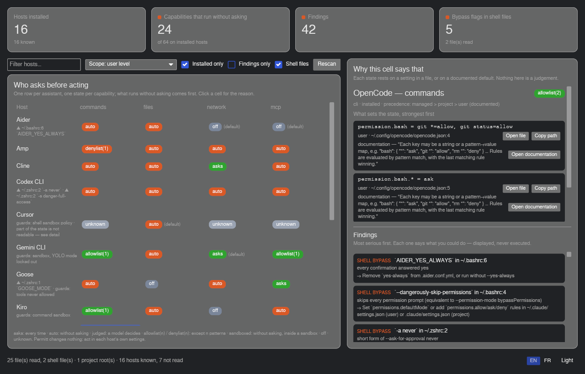

# Permitt

**What your AI agents are allowed to do on this machine without asking — and which setting
says so.**

Claude Code, Codex, Cursor, VS Code, Copilot CLI, Gemini CLI, Cline, OpenCode, Goose, Zed,
Kiro, Amp, Aider… each assistant decides for itself whether it asks before running a shell
command, editing a file, reaching the network or calling an MCP tool. The decision is
spread over a dozen files in a dozen formats, and more often than you would think the
answer is *no, it does not ask* — by default, before you changed anything. Permitt reads
those files and shows you the state. **It never writes to any of them.**

*The inspector, not the guard.* Tools exist to add hooks or sandboxes; Permitt does the
other job: it tells you what is there, where it comes from, and what to look at — then you
act in each host's own settings.

Status: **0.2.0**. Linux. 100 % Rust. MIT.



## What it shows

- **The sheet**: one row per installed assistant, one column per capability — commands,
  files, network, MCP — and one *state* in each cell: `asks`, `auto`, `judged` (a model
  decides), `allowlist(n)`, `denylist(n)`, `sandboxed`, `off`, or `unknown` with the reason.
  `(default)` marks what nothing changed. Where a project sets things differently, a second
  table for that project.
- **Where each state comes from**: the key, the file, the line, the (masked) value, and the
  documentation sentence the rule was built from.
- **Findings**, most serious first: a bypass flag in `~/.bashrc`, a capability that runs
  without asking, a deny list that is all that stands in the way, a model deciding, a
  setting written where the host ignores it, a file that could not be read.

```
$ permitt
4 host(s) installed, 5 capability(ies) run without asking, 9 finding(s)

Host           commands            files               network             mcp
OpenCode       auto (default)      auto (default)      auto (default)      auto (default)
Claude Code    judged (default)    judged (default)    judged (default)    judged (default)
               ⚑ ~/.bashrc:4 `--dangerously-skip-permissions` — skips every permission prompt
Cursor         unknown             auto (default)      unknown             unknown
Visual Studio Code (Copilot)  allowlist (default)  auto (default)  asks (default)  unknown
```

## Three promises

1. **Read-only.** No configuration file is ever written, moved or deleted; the only file
   Permitt writes is its own interface settings under `~/.config/permitt/` (desktop app,
   later).
2. **No network.** Nothing leaves the machine.
3. **Secrets masked everywhere.** A credential met in a settings file is masked the moment
   it is read.

The test suite checks the first and the third on a fake home that represents every host:
every file is byte-identical after an inventory, and no clear secret appears in the output.

## Hosts

16 hosts, every claim established from the vendor's documentation or source code, or marked
as observed on a real machine — with the URL, the date and the words it was read from. The
model, the rule schema and what we learnt are in [`docs/hosts.md`](docs/hosts.md);
`permitt hosts` prints the same from the binary. Not read yet, with the reason: Roo Code,
Kilo Code, Antigravity CLI, JetBrains, Warp, Trae.

## Install

Packages are on the [releases page](https://github.com/blackberrylabs/permitt/releases).

```bash
# Debian / Ubuntu
sudo apt install ./permitt_0.1.0-1_amd64.deb

# Fedora
sudo dnf install ./permitt-0.1.0-1.x86_64.rpm

# Any distribution
chmod +x Permitt-0.1.0-x86_64.AppImage && ./Permitt-0.1.0-x86_64.AppImage
```

Each package ships both the desktop app (`permitt-app`) and the command line (`permitt`).
From source: `cargo build --release` (Rust 1.80+).

## Command line

```bash
permitt                      # the sheet (same as `permitt roster`)
permitt findings             # what runs without asking, and why
permitt files                # the files that were looked at
permitt shell                # bypass flags found in shell start-up files
permitt hosts                # what Permitt knows about each host, and how
permitt report               # the inventory as a bbl-report/1 document (Blackberrylabs tower)
permitt --json               # for scripts
permitt --home /mnt/old      # inventory another home
permitt --root ~/work/app    # add a project root
permitt --no-shell           # skip ~/.bashrc and friends
```

## Desktop app

Same core, one window: the sheet of hosts × capabilities with coloured states, a scope
picker (user level, or each project root Claude Code knows), "installed only" /
"findings only" / "shell files" toggles; click a **cell** and the right panel shows why —
each setting with its file and line, its value, the documentation sentence the rule was
built from, and what you could do about it; the findings underneath. English by default,
French on demand; light and dark.



## Reading the sheet

- **`(default)`** is the most important word on the sheet: it means nothing in your files
  changed the built-in behaviour — and for OpenCode, Goose, Amp, Cline or Claude Code the
  built-in behaviour acts without asking.
- **`judged`** is neither `asks` nor `auto`: a model filters each call. Whether that is
  enough is your call; Permitt only says it is happening.
- **`unknown`** always comes with a reason — usually a setting the host keeps in a state
  database or a panel rather than a documented file (Cursor's Run Mode, Devin's Turbo
  mode). The detail says where to look.
- **A project row** appears only where a project file changes the state; the rest of the
  sheet is the user level.
- **A deny list is not a wall**: `denylist(n)` means the agent acts without asking except
  for n patterns, and a command can usually be spelled another way.

## Part of Blackberrylabs

Permitt is a module of the [Blackberrylabs](https://github.com/blackberrylabs) control
tower, which gathers what Permitt, MCProster and Cleanator find on a machine in one list, most serious
first. `permitt report` is what the tower reads; `permitt-app --select` is how it opens Permitt
at a finding. Each tool stays complete and installable on its own.

## How it is built

A Rust workspace: `crates/core` (rules, sheets, shell scan, findings — no UI, no network),
`crates/cli`, `crates/app` (iced). Host rules in `hosts/*.toml`, embedded in the binary. The rule schema,
path resolution, file readers and secret masking come from
[`bbl-hostrules`](https://github.com/blackberrylabs/bbl-hostrules), the crate shared by the
Blackberrylabs tools; the interface from [`bbl-ui`](https://github.com/blackberrylabs/bbl-ui);
`permitt report` speaks [`bbl-report`](https://github.com/blackberrylabs/bbl-report), the
contract of the Blackberrylabs control tower. `#![forbid(unsafe_code)]` everywhere. The design brief, plan and
journal are kept in French at the root; code, comments and documentation are in English.

By [Alexandre Do](https://github.com/blackberrylabs), who also made
[MCProster](https://github.com/blackberrylabs/mcproster) (every MCP server on your machine,
in one list), [Cleanator](https://github.com/blackberrylabs/cleanator) (a disk cleaner for
developers who run AI on Linux) and [Linstruct](https://github.com/blackberrylabs/linstruct)
(your AI instruction files as each agent reads them) — same principle: show, explain, never
act in your place.

## License

MIT — see [LICENSE](LICENSE).
